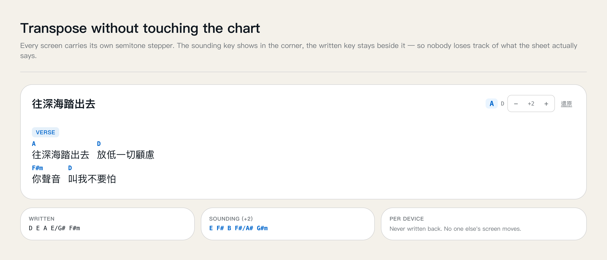
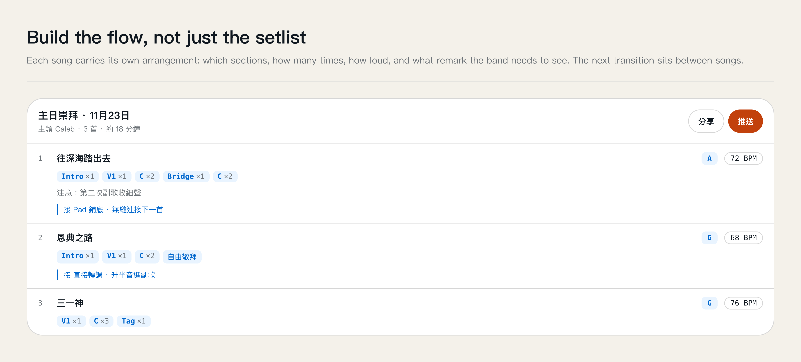
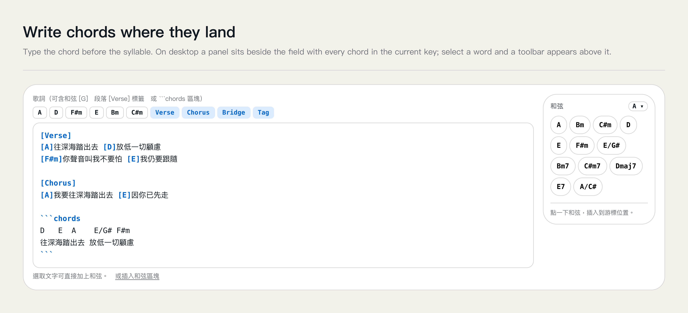

# Sync Worship

**A worship stage display for church teams who are tired of guessing what song is next.**

[](https://ko-fi.com/E2V52B1CCI)

Sync Worship keeps a song library, builds the order of service, and pushes the current song to every screen on stage — chords, lyrics, key, and what happens after the last chorus. A tablet at the front of the room shows what the band's music stand shows.

The interface is **Traditional Chinese only** for now. The code and this document are in English.

<sub>**English** · [繁體中文](README.zh-Hant.md)</sub>

---

## What it does

- **Song library** — upload a chord-sheet PDF or a photo of one. It gets converted to compressed WebP pages, and page one is read by OCR to pull out lyrics and chords.
- **Worship lists** — order the songs, set each one's key, tempo, and section flow, and add transition notes.
- **Realtime push** — the leader taps push; every stage device switches to that song at the same moment.
- **Stage display** — large lyrics with chords above each syllable, a key transposer, and a section counter so you know how many choruses are left.
- **Offline** — songs and lists are cached. If the church Wi-Fi drops mid-set, the screens keep working.
- **Share links** — send a read-only link to a guest musician who does not have an account.

## The problem

A worship team runs on paper. Someone prints chord sheets, someone else pencilled in a key change, and the sheets get lost between practices. When the leader says "let's go to the bridge", every musician hunts through their own stack.

Sync Worship replaces the stack. One person builds the list, everyone else reads from the same screen.

---

## How to use it

1. **Sign in.** The team shares one account. After signing in, name your device in Settings — that name appears when you push, so people know where it came from.
2. **Add a song.** Upload the chord sheet. Check what OCR read — the sheet image is always there, so you can compare. Fix the lyrics if needed.
3. **Edit the lyrics** with chords written inline: `[G]奇異恩典 [C]何等甘甜`. The chord toolbar sits above the field, and on a desktop a panel sits beside it with every chord in the current key.
4. **Build a list.** Add songs, drag to reorder, then set each song's key, tempo, section flow, and transitions.
5. **Open the list on stage.** Tap 推送 (push) and the current song appears on every device.
6. **Transpose as needed.** Each screen can move the key up or down without affecting anyone else.

## Transpose without touching the chart



Every display carries its own semitone stepper. The sounding key shows in the corner with the written key beside it, so a guitarist reading a transposed screen still knows what the sheet says. Nothing is written back: one person's transposition never moves anyone else's screen.

## Build the flow, not just the setlist



A list is more than an order. Each song carries its arrangement — which sections, how many passes, how loud, and the remark the band needs to see — and the transition sits between songs: a pad underneath, a direct modulation, a seamless join into the next key.

## Write chords where they land



Type the chord before the syllable it lands on. Chords go in square brackets, so the same field holds lyrics, chords, and section labels. On a desktop a panel sits beside the field with every chord in the current key; select a word and a toolbar appears above it; on a phone the toolbar sits above the field instead.

## The rest of the app

The four panels in [`docs/`](docs) walk through the whole thing end to end — overview, lists, library, stage.

---

## Chord syntax

Two ways to write chords.

**Inline** — the chord goes in square brackets directly before the syllable it lands on:

```
[G]奇異恩典 [C]何等甘[G]甜
```

**Aligned blocks** — for passages where one word carries two chords, spacing carries meaning:

````
```chords
D   E  A    E/G# F#m
往深海踏出去 放低一切顧慮
```
````

The block renders in a monospaced panel and keeps its columns. It does not wrap, because the columns *are* the notation.

Section labels work in either form: `[Verse]`, `[Chorus]`, `[Bridge]`, `[Tag]`, and their Chinese equivalents.

## Key transposition

Every display — the song page and the stage — carries a semitone stepper. The sounding key shows in the corner with the written key beside it once you move. Transposition is per-device and per-view: nothing is written back to the song, so you cannot accidentally save a transposed chart over the original.

---

## Why these choices

**WebP instead of the original files.** A 10 MB PDF holds maybe four readable pages. Converted to WebP at 1100 px and quality 80, those pages come to a few hundred KB, which is what makes offline caching on a tablet realistic. It also means the original file is never uploaded or stored — you keep your own backup, and the server only ever holds images.

**OCR on page one only.** The first page of a chord sheet usually carries the title, key, composer, and the first verse with chords. Reading one page costs a few seconds; reading thirty costs a minute and mostly produces text you would have to correct anyway. What OCR cannot do is read a staff or numbered-notation lead sheet — the app detects those and leaves the lyrics field alone rather than filling it with nonsense.

**LRCLIB for lyrics, as an experiment.** It is a free, open, community-maintained lyrics database with a plain HTTP API and no CORS restrictions, so the browser can call it directly with no proxy. The catch is coverage: it is built around recorded popular music, so English worship songs fare well and Cantonese or Mandarin worship songs often return nothing. When it does find something, the result is frequently in Simplified Chinese. The search sits behind a button labelled 實驗 (experimental) and always shows you a preview before inserting anything.

---

## Self-hosting

You need Node 20+ and a Supabase project.

```bash
git clone https://github.com/incensestudio852/syncworship.git
cd syncworship
npm install
```

Open your Supabase SQL editor, paste the whole of **`supabase/setup.sql`**, and run it. It is idempotent — run it again whenever you like. It ends by listing the tables and functions it created, so you can see it worked.

Then set:

```
NEXT_PUBLIC_SUPABASE_URL=https://<your-project-ref>.supabase.co
NEXT_PUBLIC_SUPABASE_ANON_KEY=<your publishable key>
```

```bash
npm run dev      # local, includes the asset copy step
npm run build    # static export to out/
npm run deploy   # build + wrangler deploy
```

### Where it runs

The reference deployment is **Supabase** (database, auth, storage, realtime) plus
**Cloudflare Workers** serving the static build — that combination is what the
author runs, and `DEPLOY.md` documents it step by step.

Cloudflare is not required. The build is a plain static export, so it also runs on
Netlify, Vercel, GitHub Pages, nginx, or a box on the church network. Two things
are Cloudflare-specific and are only needed for the share-link preview cards: the
`worker.ts` router and the `functions/` edge handlers. Without them the app works
normally, minus the social preview images. `DEPLOY.md` lists what to change.

What you cannot skip is Supabase. The app has no server of its own — there is no
API layer to substitute, so the Postgres database, auth, and storage bucket all
have to exist somewhere.

**Two things that will trip you up:**

- The app is a **static export**. There is no server runtime, no API routes, no middleware. Anything that needs a server lives in `functions/` or `worker.ts` as a separate edge layer.
- `pg_cron` is optional. The setup file checks for it and prints a notice if it is missing rather than failing. Without it, the three-month cleanup of old lists never runs — everything else works.
- The numbered files in `supabase/steps/` are the original incremental history. You do not need them; `setup.sql` is those files merged and made re-runnable.

## Tech

Next.js (static export) · Supabase (Postgres, Auth, Storage, Realtime) · Cloudflare Workers · Tesseract.js for OCR · pdf.js for PDF rendering · opencc-js for Simplified-to-Traditional conversion.

Deliberate constraints: 10 MB upload cap, 1100 px WebP output, 30 page PDF limit, one shared team account, no original file retention.

---

## Credits

The chord arrangement used as the sample in the app comes from **原始和聲 Raw Harmony**, whose chord sheets are public at [rawharmony.hk/chords](https://www.rawharmony.hk/chords). Thank you for making them freely available.

If these songs have been useful to you, **支持詩歌創作，歡迎按感動奉獻給作者們** — please consider supporting the people who wrote them.

## Content and copyright

This repository contains **no song lyrics and no chord sheets**. The only arrangement that appears anywhere in the source is a two-line sample from Raw Harmony, credited above, used so the chord-block syntax has a working example.

Anything you upload to your own deployment is yours to account for. Lyrics and chord sheets are usually somebody's copyright. Churches typically rely on a licence such as CCLI for exactly this reason. This project takes no position on that and cannot grant permissions it does not hold. **You are responsible for the content you upload.**

## Support

Issues and pull requests are welcome. There is no support commitment — this is a tool its author uses, shared in case it helps someone else.

## License

MIT. See [LICENSE](LICENSE).

[](https://ko-fi.com/E2V52B1CCI)
