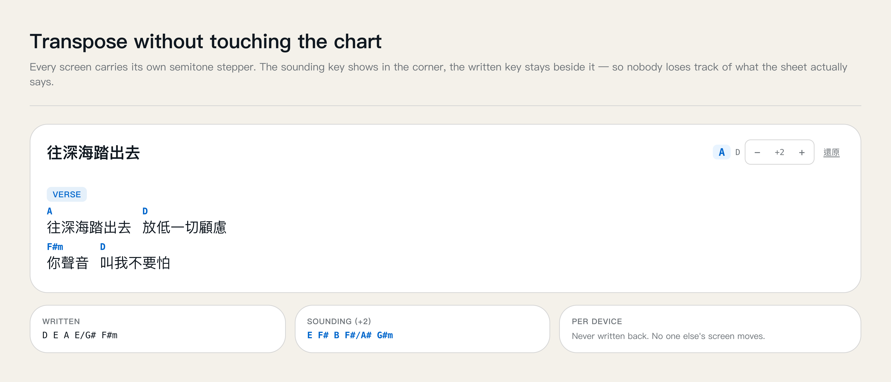
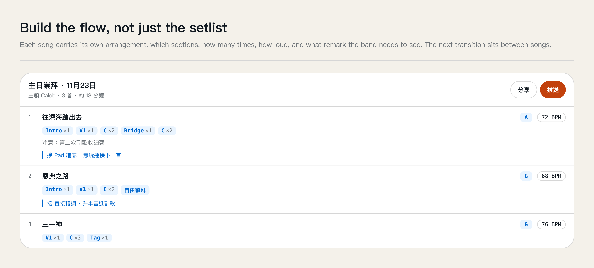
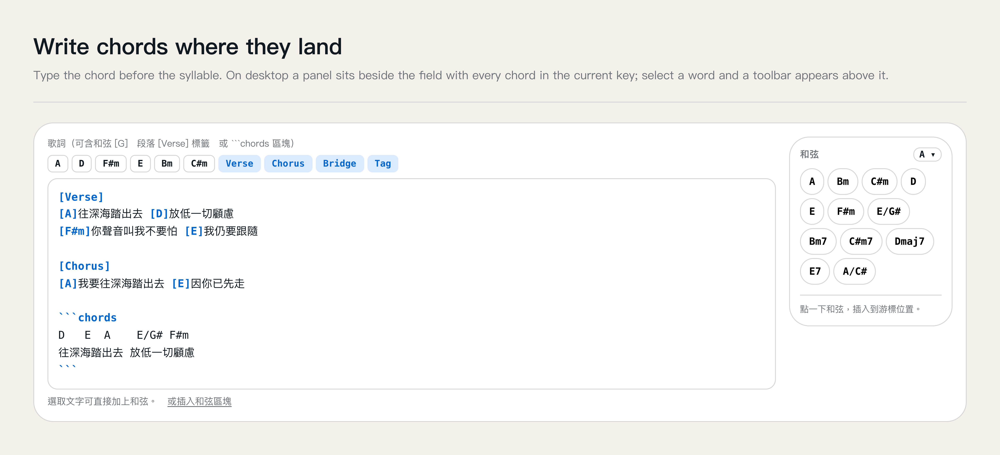

# Sync Worship 同步敬拜

**給不想再猜下一首是甚麼詩歌的敬拜隊，一個放上舞台的屏幕。**

[](https://ko-fi.com/E2V52B1CCI)

Sync Worship 管住詩歌庫，排好崇拜流程，再把目前這首歌推到台上每一塊屏幕。和弦、歌詞、調性，還有最後一段副歌之後接甚麼，全部同步。台前那部平板顯示的，就是樂手譜架上那一份。

介面目前只有繁體中文。

<sub>[English](README.md) · **繁體中文**</sub>

---

## 它做甚麼

- **詩歌庫** — 上傳和弦譜 PDF 或譜面照片。檔案會轉成壓縮的 WebP 頁面，第一頁交給 OCR 讀出歌詞與和弦。
- **敬拜清單** — 排歌序，為每首歌設定調性、速度、段落流程，並加上轉接備註。
- **即時推送** — 主領按下推送，台上每部裝置同時跳到那首歌。
- **舞台顯示** — 大字歌詞，和弦落在每個字上面，附移調器與段落計數，讓你知還剩幾次副歌。
- **離線可用** — 詩歌與清單會快取。教會 Wi-Fi 中途斷線，屏幕照樣運作。
- **分享連結** — 給沒有帳號的客席樂手一條唯讀連結。

## 解決的問題

敬拜隊靠紙本運作。有人印譜，有人在譜上鉛筆改了調，排練之間紙就不見了。主領說「去 bridge」，每個樂手各自翻自己那一疊。

Sync Worship 取代那疊紙。一個人排清單，其他人看同一個畫面。

---

## 怎麼用

1. **登入。** 全隊共用一個帳號。登入後在設定為這部裝置命名。推送時會顯示這個名字，大家就知道是誰推的。
2. **新增詩歌。** 上傳和弦譜。核對 OCR 讀出的內容。譜面圖一直都在，可以對照。歌詞有誤就改。
3. **編輯歌詞。** 和弦直接寫在字前：`[G]奇異恩典 [C]何等甘甜`。輸入框上方有和弦列；桌面版在旁邊另有一個面板，列出目前調性的所有和弦。
4. **建立清單。** 加入詩歌，拖曳排序，再逐首設定調性、速度、段落流程與轉接。
5. **在台上開啟清單。** 按推送，當前詩歌就會出現在每部裝置上。
6. **需要時移調。** 每個屏幕各自升調降調，互不影響。

## 移調，不動原譜



每個顯示畫面都有自己的半音升降器。發聲的調顯示在角落，旁邊補上原調，所以即使看著移調後的畫面，樂手仍然知道譜上寫的是甚麼。移調不會寫回詩歌，一個人升調，旁邊的屏幕不會跟著動。

## 排的是流程，不只是歌序



清單不只是先後次序。每首歌記住自己的編排：走哪些段落、每個段落幾次、力度，以及樂手需要看見的備註。轉接放在歌與歌之間——底下墊 pad、直接轉調，或者無縫接到下一個調。

## 和弦寫在字前



和弦直接打在中括號裡，貼著它對應的那個字。同一個欄位同時放歌詞、和弦與段落標籤。桌面版在輸入框旁邊另有一個面板，列出目前調性的所有和弦；選取文字，工具列就浮在字的上方；手機版則把工具列放在輸入框上面。

## 其餘畫面

[`docs/`](docs) 內四張圖完整走一遍：總覽、清單、詩歌庫、舞台。

---

## 和弦語法

兩種寫法。

**行內** — 和弦放在中括號內，緊貼它對應的那個字：

```
[G]奇異恩典 [C]何等甘[G]甜
```

**對齊區塊** — 一個字要配兩個和弦時，用空白對位：

````
```chords
D   E  A    E/G# F#m
往深海踏出去 放低一切顧慮
```
````

區塊以等寬字體顯示，欄位位置保留。不會換行，因為欄位本身就是記譜。

段落標籤兩種寫法都通：`[Verse]`、`[Chorus]`、`[Bridge]`、`[Tag]`，中文標籤同樣可以。

## 移調

每個顯示畫面都有半音升降器，詩歌頁與舞台皆然。實際發聲的調顯示在角落，移調後旁邊會補上原調。移調只作用於這部裝置、這個畫面：不會寫回詩歌本身，所以不會誤把移調後的譜存成原譜。

---

## 為甚麼這樣選

**用 WebP，不用原檔。** 一份 10 MB 的 PDF 大概只有四頁讀得清楚。以 1100 px、品質 80 轉成 WebP 之後，那幾頁只剩幾百 KB，平板上的離線快取才做得起。原檔從不上傳、不儲存：備份自己留住，伺服器只有圖片。

**OCR 只讀第一頁。** 和弦譜第一頁通常已有歌名、調性、作者與第一段配和弦的歌詞。讀一頁只需幾秒；讀三十頁要一分鐘，產出的內容大部分你還是得改。OCR 讀不了五線譜與簡譜——系統會辨識出這類譜面，並且不去動歌詞欄，不會把亂碼填進去。

**用 LRCLIB 找歌詞，屬實驗性質。** 它是一個免費、開放、由社群維護的歌詞資料庫，提供簡單的 HTTP API，也沒有 CORS 限制，瀏覽器可以直接呼叫，不需要中間層代理。問題在涵蓋率：資料庫以流行唱片為主，英文敬拜歌找得到，廣東話與普通話敬拜歌經常一條也沒有。就算找到，也常是簡體中文。這個搜尋藏在一個標示「實驗」的按鈕後面，而且一定先給你預覽，才讓你插入。

---

## 自行架設

需要 Node 20 以上，以及一個 Supabase 專案。

```bash
git clone https://github.com/incensestudio852/syncworship.git
cd syncworship
npm install
```

打開 Supabase 的 SQL editor，把整份 **`supabase/setup.sql`** 貼上執行。這份檔案可以重複執行，想再跑一次也沒問題。跑完會列出它建立的資料表與函式，讓你確認成功。

然後設定：

```
NEXT_PUBLIC_SUPABASE_URL=https://<your-project-ref>.supabase.co
NEXT_PUBLIC_SUPABASE_ANON_KEY=<your publishable key>
```

```bash
npm run dev      # 本機開發，含資源複製步驟
npm run build    # 靜態匯出到 out/
npm run deploy   # 建置後 wrangler deploy
```

### 跑在哪裡

作者自己在用的是 **Supabase**（資料庫、登入、儲存、即時同步）加 **Cloudflare Workers** 提供靜態檔案，`DEPLOY.md` 把這條路逐步寫清楚。

Cloudflare 不是必需的。建置結果就是一組靜態檔案，放上 Netlify、Vercel、GitHub Pages、nginx，或者教會內網的一台機器都可以。只有兩樣東西綁住 Cloudflare，而且只為了分享連結的預覽圖：`worker.ts` 的路由，以及 `functions/` 的邊緣處理。少了它們，應用照常運作，只是沒有社群預覽圖。要改哪些地方，`DEPLOY.md` 有列。

不能跳過的是 Supabase。這個應用沒有自己的伺服器——沒有 API 層可以替換，所以 Postgres、登入、儲存桶都得各自存在。

**兩個容易踩到的坑：**

- 本專案是**靜態匯出**。沒有伺服器執行環境，沒有 API route，沒有 middleware。需要伺服器的東西放在 `functions/` 或 `worker.ts`，是獨立的一層。
- `pg_cron` 是可選的。setup 檔會先檢查，沒有就印出提示，不會中斷。沒有它，三個月的舊清單自動清除不會執行，其餘功能照常。
- `supabase/steps/` 內的編號檔案是原本的逐步紀錄。你不需要它們；`setup.sql` 就是那些檔案合併、並改成可重複執行的版本。

## 技術

Next.js（靜態匯出）· Supabase（Postgres、Auth、Storage、Realtime）· Cloudflare Workers · Tesseract.js 負責 OCR · pdf.js 負責 PDF 轉圖 · opencc-js 負責簡繁轉換。

刻意的限制：上傳上限 10 MB、WebP 寬度上限 1100 px、PDF 最多 30 頁、全隊共用一個帳號、不保留原始檔案。

---

## 鳴謝

應用程式中的示範和弦譜來自 **原始和聲 Raw Harmony**，他們的和弦譜公開於 [rawharmony.hk/chords](https://www.rawharmony.hk/chords)。多謝他們無償公開。

如果這些詩歌對你有幫助，**支持詩歌創作，歡迎按感動奉獻給作者們。**

## 內容與版權

本儲存庫**不含任何歌詞與和弦譜**。原始碼中唯一的樂譜片段，是上方鳴謝的原始和聲那兩行示範，用途是讓對齊區塊的語法有個可運作的例子。

你自己部署時上傳的內容，由你自己負責。歌詞與和弦譜通常有版權，教會一般會以 CCLI 之類的授權處理，正是為此。本專案不對此表態，也無法授予它並不持有的授權。**你上傳的內容，責任在你。**

## 支援

歡迎開 issue 與 pull request。但沒有支援承諾——這是作者自己在用的工具，順便分享出來。

## 授權

MIT，見 [LICENSE](LICENSE)。

---

Sync Worship 免費，也會一直免費。如果它替你的團隊省下一個主日早上的忙亂，歡迎請我喝杯咖啡。

[](https://ko-fi.com/E2V52B1CCI)
